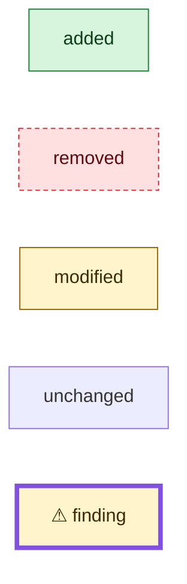

# Diagrams

Drawing rules for the aggregator, applied once findings are numbered. Draw the change so a reviewer sees at a glance what was added, removed, and modified, and where the problems are.

**Inputs:** `<run>/context/brief.md`, `files.tsv`, `symbols.tsv` (the source of truth for added/removed/modified), your numbered `F…` findings (ids, gates, locations), and `diff.patch` sections as needed. Write `<run>/diagrams.md`. In *redacted* security mode, security issues are never marked or mentioned.

## What to draw

Focused Mermaid diagrams, at least:

1. **Data types** the change adds or alters — `classDiagram` (or `flowchart` when relations matter more than fields).
2. **Client interaction** — the call sequence from the caller's side (`sequenceDiagram`).
3. **Inner workings** — the internal flow across packages and layers (`flowchart`).

Show unchanged elements only for context, unstyled. Skip a diagram whose subject the change doesn't touch. If the change alters no type, contract, or flow, write a one-line `diagrams.md` saying so.

## Colors

Open the file with this legend; use the same classes everywhere:

````markdown

````

- **flowchart** — repeat the three `classDef` lines; tag nodes `:::added`, `:::removed`, `:::modified`. Edges touching removed nodes use `-.-x`.
- **classDiagram** — same `classDef`s, applied with `class Name:::added`. When a class is only modified, suffix its changed members with `+ new` or `- removed`.
- **sequenceDiagram** — wrap steps in `rect rgb(215,245,221)` (added), `rect rgb(255,224,224)` (removed), or `rect rgb(255,244,204)` (modified).

## Findings

Mark every finding whose location is drawn:

- **flowchart / classDiagram** — append `⚠ F<n> G<g>` to the label and add `style <id> stroke:#8250df,stroke-width:4px`. The inline style overrides the border; the fill still shows the change status.
- **sequenceDiagram** — `Note over <participant>: ⚠ F<n> G<g> <short title>` at the step.
- Add a node when a G3/G4 site is essential to the flow but not yet drawn.

End with a table of G3/G4 findings not shown on any diagram (`F<n> | why`), so nothing serious goes missing.

## Syntax

Quote labels with punctuation (`id["Pool.AquireModel(ctx)"]`), no `;` in labels, alphanumeric node ids, under ~40 nodes per diagram — split rather than cram.

